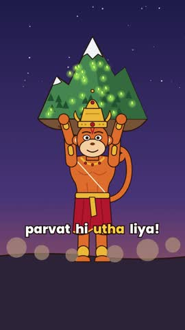
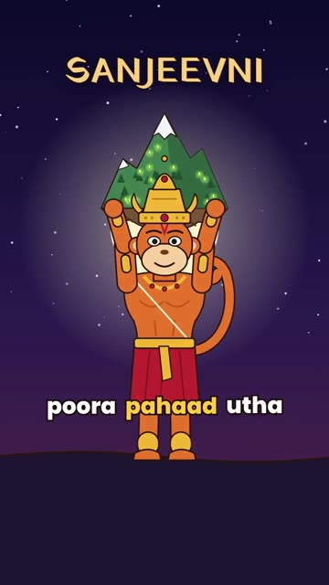
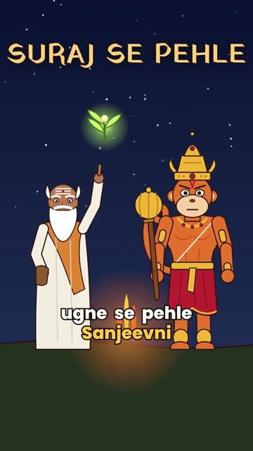
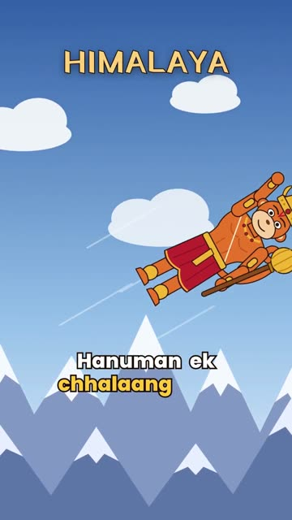
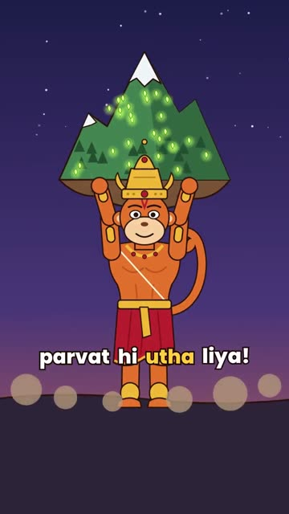
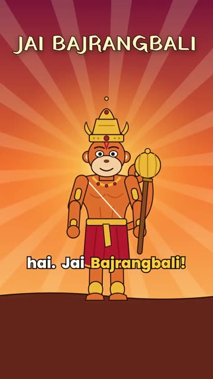
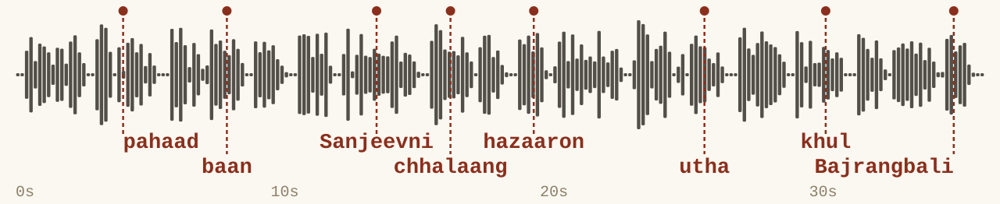
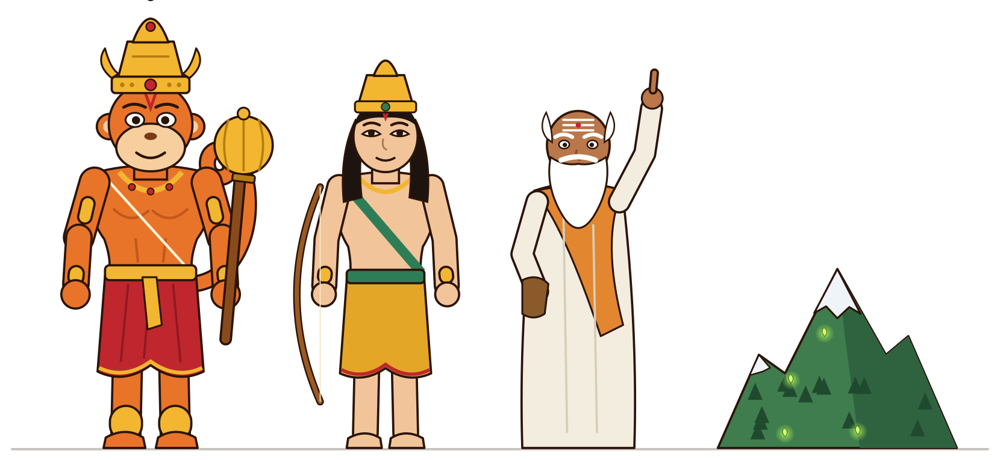

# AI Animated Mythology Reels

Turn a story idea into a 2D animated reel with [Claude Code](https://claude.com/claude-code).
Every character is drawn in code, every action lands on its spoken word, and no AI image
generator is involved, so Hanuman looks the same in every scene.

> **Status: V1.** This is the first working version, and I'm still improving it.
> Ideas, [issues](https://github.com/thepiyushbansal/ai-mythology-reels/issues) and pull requests are welcome.

**Sample: _Sanjeevni_, 37 seconds, Hindi voiceover with Hinglish captions**

[](media/sanjeevni-reel.mp4)

[Watch the reel](media/sanjeevni-reel.mp4) ·
[Read how it was made](https://piyushbansal.pages.dev/projects/reel-pipeline/) ·
[Get the step-by-step PDF](https://piyushbansal.pages.dev/get-workflow/?w=reels)

| pahaad | Sanjeevni | chhalaang | utha | Bajrangbali |
|---|---|---|---|---|
|  |  |  |  |  |

Each still is caught on the word its action is timed to.

## How it works

You give Claude Code a story and approve two things: the scene plan and the character designs.
It runs the rest.

| Step | Tools | What happens |
|---|---|---|
| 1. Script | Claude | About 80 words of Hinglish in 8 scenes: hook, story, moral. Each line marks one key word where that scene's main action lands. |
| 2. Voice | Kokoro, Whisper | Kokoro, an open-source voice model, reads the Hindi script on your computer. Every word gets a timestamp, checked with Whisper. |
| 3. Characters | Python, SVG | Hanuman, Lakshman, Vaidya Sushen and the Dronagiri mountain are drawn as SVG code: shapes, not pixels. |
| 4. Animation | GSAP, HyperFrames | Each scene is a web page animated with GSAP, timed so the action hits its key word. Captions light up word by word. |
| 5. Mix + render | numpy, FFmpeg, HyperFrames | The voice is mixed with a drone and sound effects made in code, then HyperFrames films the page frame by frame into a vertical MP4. |





## What's in here

```
reel/
  script.py           the story: 8 lines in Hindi (for the voice) and Hinglish (for captions), plus each line's key word
  voice.py            step 2: speaks every line with Kokoro, writes assets/voice_raw.wav + timings.json
  transcribe.py       step 2 check (optional): Whisper word times, writes whisper_words.json
  art.py              step 3: the characters, sky, ground and props, all as SVG-drawing functions
  sheet.py            draws every character on one page (sheet.html) so you can approve the designs
  build.py            steps 4-5: writes index.html (all scenes + GSAP timeline) and assets/mix.wav (voice + music + effects)
  timings.json        line and word timings from voice.py (already generated for the sample)
  whisper_words.json  word timings from transcribe.py (already generated for the sample)
  assets/             the voiceover, and the two fonts used for captions and titles
media/                the finished sample reel and the pictures in this README
```

## Make the sample yourself

You need Python 3.10+, Node.js 18+ and [FFmpeg](https://ffmpeg.org/).

```bash
git clone https://github.com/thepiyushbansal/ai-mythology-reels.git
cd ai-mythology-reels
pip install numpy soundfile
cd reel

# GSAP (the animation library) is downloaded, not stored in this repo
curl -L -o assets/gsap.min.js https://cdn.jsdelivr.net/npm/gsap@3.12.5/dist/gsap.min.js

python3 build.py                                   # writes index.html and assets/mix.wav
npx hyperframes@0.8.214 render -o renders/sanjeevni.mp4
```

The voiceover for the sample is already in `assets/voice_raw.wav`, so the steps above don't need the voice model.

### Make your own story

1. Edit `script.py`: write your lines in Hindi (`hi`) and Hinglish (`en`), and pick each line's `key` word.
2. New voice: `pip install kokoro-onnx`, download `kokoro-v1.0.int8.onnx` and `voices-v1.0.bin`
   from the [kokoro-onnx releases](https://github.com/thewh1teagle/kokoro-onnx/releases) into `~/tts/`, then run
   `python3 voice.py` (optional arguments: voice name, speed; default `hm_omega 1.05`).
3. Optional word check: `pip install faster-whisper`, then `python3 transcribe.py`.
4. New characters or scenes: add drawing functions to `art.py` and scenes to `build.py`.
   `python3 sheet.py` draws your cast on one page to review before animating.
5. Run `python3 build.py` and render as above.

Or open the folder in Claude Code and describe the story you want: that's how this one was made.

## What's next

This is V1: one story, Sanjeevni. Next up:

- More stories with the same cast. The characters and every step are reusable, so a new story starts at the script.
- A step-by-step PDF guide: the tools, the prompts, the setup and the mistakes to skip
  ([leave your email to get it](https://piyushbansal.pages.dev/get-workflow/?w=reels)).

## Credits

- The approach started from Rahul's (@SocialCanvasbyRahul) playbook for 2D mythology reels.
- [Kokoro](https://github.com/thewh1teagle/kokoro-onnx) (Apache-2.0) for the voice, [faster-whisper](https://github.com/SYSTRAN/faster-whisper) for word timings,
  [HyperFrames](https://www.npmjs.com/package/hyperframes) for rendering, [GSAP](https://gsap.com) for animation
  (downloaded during setup, under its own [license](https://gsap.com/standard-license)).
- Fonts: Poppins and Yatra One, under the SIL Open Font License (see `reel/assets/fonts/`).

## License

The code is MIT licensed (see `LICENSE`). Fonts keep their own OFL licenses.

Made by [Piyush Bansal](https://piyushbansal.pages.dev).
